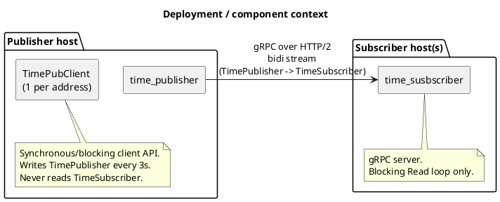
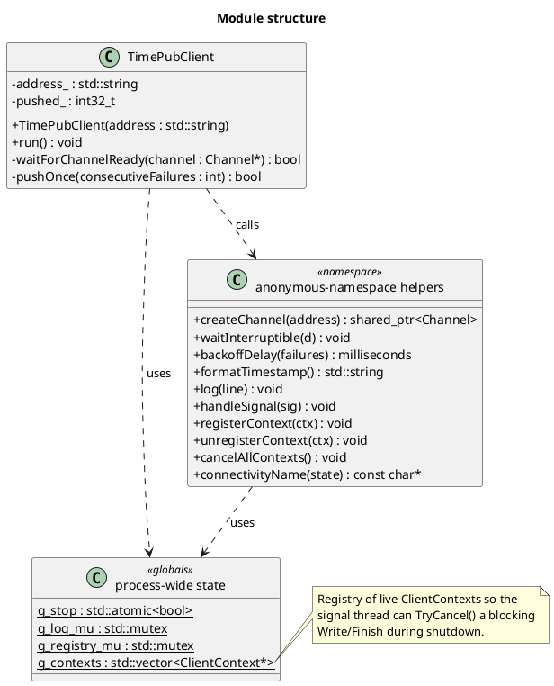
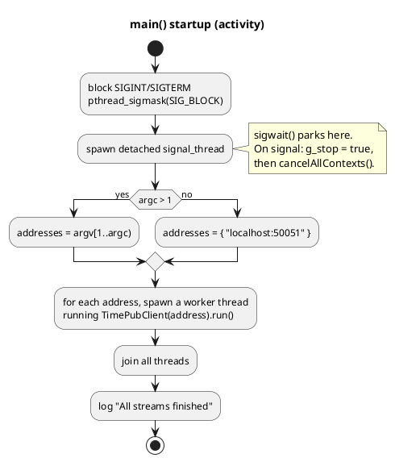
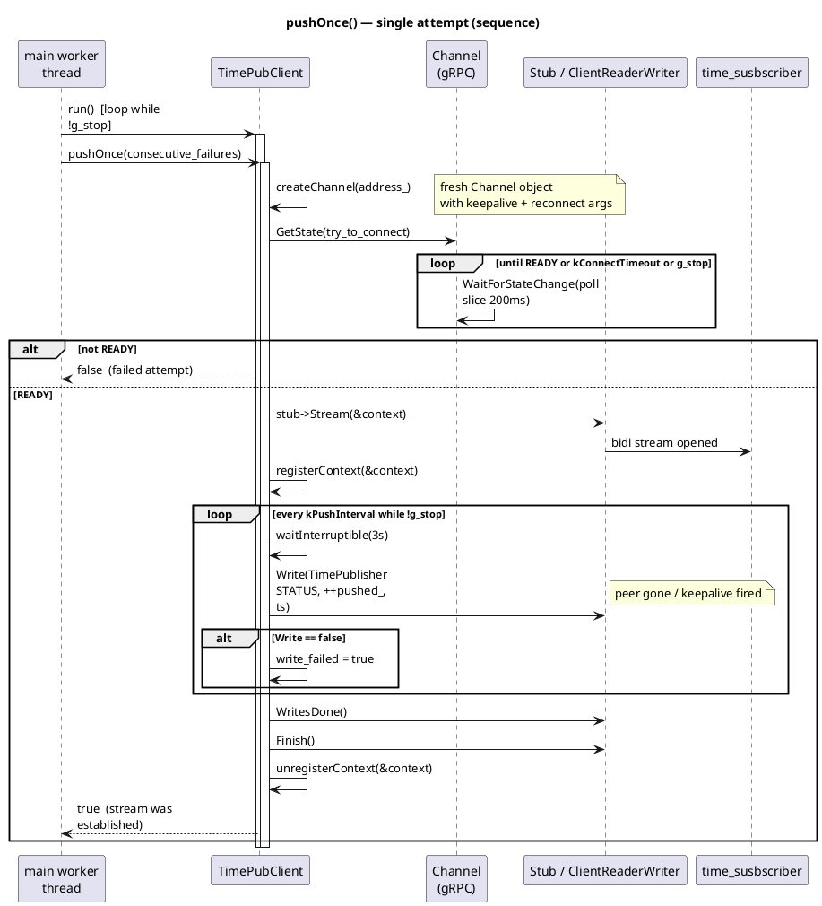
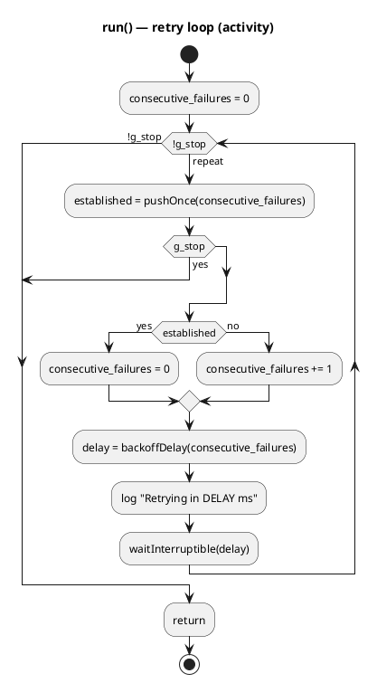
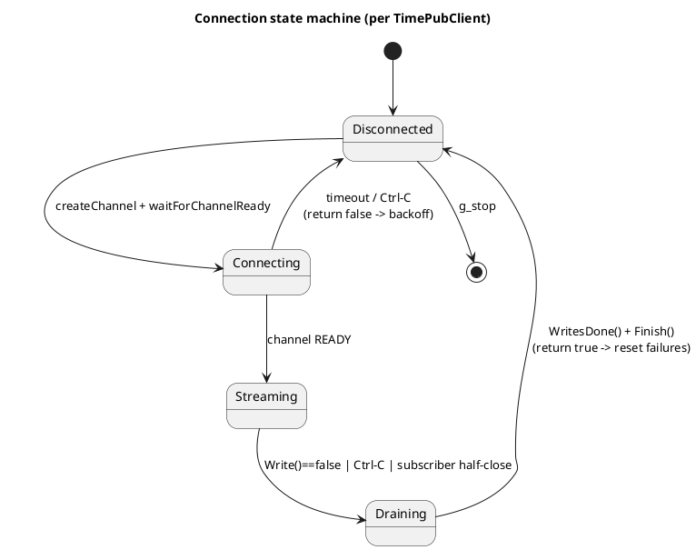
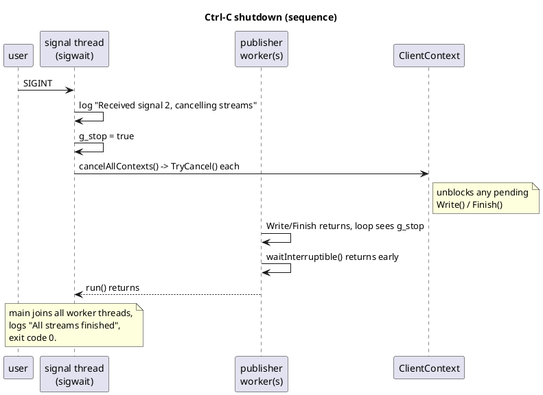

# `time_publisher.cpp` — Design Document

Status: current
Scope: the gRPC **client / pusher** process in this repository (`time_publisher.cpp`), its
threading, connection lifecycle, retry strategy and shutdown behaviour.

> Every PlantUML block below renders with any PlantUML tool (plantuml.com, VS Code
> "PlantUML" extension, `plantuml.jar`, or GitHub when the PlantUML app is installed).

---

## 1. Purpose

`time_publisher` dials one or more `time_susbscriber` processes over a **bidirectional
gRPC stream** and writes a formatted date/time message every 3 seconds. It is a pure
**writer**: it never reads application data on the stream. Its hard requirements are:

- **Survive an absent or restarting subscriber** — start before the subscriber, retry
  forever, never exit on a connection error.
- **Detect a dead connection** instead of blocking a blocking `Write` forever on a
  silently dead TCP path (HTTP/2 keepalive).
- **Resume, not restart** — keep the push counter across reconnects so the subscriber can
  tell it is the same publisher.
- **Exit cleanly (code 0) on Ctrl-C**, including from inside a blocking `Write` or a retry
  sleep.

## 2. Context and roles

- `time_publisher.cpp` — gRPC **client**, the only writer.
- `time_susbscriber.cpp` — gRPC **server**, the only reader.
- `service.proto` — the contract (see §3).

The timestamp travels in `TimePublisher.message` because a gRPC client can only write the
**first** message type of a bidi RPC, and the RPC is declared
`rpc Stream(stream TimePublisher) returns (stream TimeSubscriber)`.



## 3. RPC contract

```proto
enum Opcode { UNKNOWN=0; PING=1; DATA=2; STATUS=3; CLOSE=4; }

message TimeSubscriber { Opcode opcode=1; int32 id=2; bool active=3; float value=5; }
message TimePublisher  { Opcode opcode=1; int32 id=2; string message=3; bool success=4; float result=5; }

service TimePubService { rpc Stream(stream TimePublisher) returns (stream TimeSubscriber); }
```

`time_publisher.cpp` always sends `opcode = STATUS`, `id = pushed_` (monotonic push
counter), `message = formatTimestamp()`, `success = true`, `result = 0.0`. It writes
nothing else and reads nothing.

## 4. Code map (structure)

The translation unit is a single class (`TimePubClient`) over a set of `namespace`-scoped
free functions and process-wide state.



## 5. Startup and threading model

`main()` blocks `SIGINT`/`SIGTERM`, starts one detached `sigwait` thread, then spawns one
`std::thread` per subscriber address. Each thread owns a `TimePubClient` and loops inside
`run()` until `g_stop` is set.



**Thread inventory**

| Thread | Started by | Lifetime | Role |
| --- | --- | --- | --- |
| `main` | process | whole run | parse args, spawn/join worker threads |
| signal thread | `main` (detached) | whole run | `sigwait`, set `g_stop`, cancel all streams |
| publisher worker × N | `main` (one per address) | until `g_stop` | independent dial/push/retry loop |
| gRPC internals | gRPC library | per channel | transport |

Shared state is limited to `g_stop` (`std::atomic<bool>`), `g_log_mu` (stdout), and the
`ClientContext` registry guarded by `g_registry_mu`. `pushed_` is **not** shared — it lives
inside each `TimePubClient`, so no cross-thread synchronisation is needed.

## 6. Per-attempt connection lifecycle

One attempt is `pushOnce(consecutive_failures)`. It builds a **fresh channel per attempt**,
waits for `GRPC_CHANNEL_READY`, opens the stream, pushes every 3s, then drains.



**Return-value contract.** `pushOnce` returns `false` only when the transport never became
`READY` (so `run()` grows the backoff). Once a stream is up, it returns `true`, which
**resets** `consecutive_failures` — a recovered connection is therefore retried within ~1s
instead of after the grown penalty.

## 7. Retry, backoff and recovery

`run()` is a retry loop around `pushOnce`. The delay is a **jittered exponential backoff**:
`min(kRetryInitial << min(failures, kMaxBackoffShift), kRetryMax)`, then a uniform random
value in `[0, ceiling)`. Jitter prevents a fleet of publishers from reconnect-storming a
restarted subscriber in lockstep. The RNG is a `thread_local std::mt19937` so each worker
thread has its own.





**Backoff behaviour**

| `consecutive_failures` | ceiling | actual delay |
| --- | --- | --- |
| 0 (first retry after a lost stream) | 1s | `[0, 1s)` |
| 1 | 2s | `[0, 2s)` |
| 2 | 4s | `[0, 4s)` |
| 3 | 8s | `[0, 8s)` |
| ≥ 4 | 15s (`kRetryMax`) | `[0, 15s)` |

## 8. Keepalive and dead-peer detection

A blocking `Write` alone cannot detect a peer whose path went silent: the kernel keeps
ACKing the TCP connection. HTTP/2 keepalive is what turns that into a failed RPC:

- `K_KEEP_ALIVE_TIME_MS = 30000`, `K_KEEP_ALIVE_TIMEOUT_MS = 10000`.
- `GRPC_ARG_HTTP2_MAX_PINGS_WITHOUT_DATA = 0` (unlimited pings between data frames).

Since this process is the sole writer and receives nothing, gRPC's keepalive timer — reset
only by **incoming** bytes — fires on schedule regardless of push traffic. The cadence is
kept an order of magnitude above the 3s push interval to stay clear of the server's
ping-strike policy and the ping/BDP traffic our own pushes generate. Detection budget for a
silent path is therefore `30s + 10s = 40s`.

## 9. Signal handling and graceful shutdown

A flag cannot unblock a blocking `Write` or `Finish`, so shutdown is a two-part operation:
set `g_stop`, then cancel every live `ClientContext` via `TryCancel()`.



`waitInterruptible(d)` sleeps in 200ms slices and re-checks `g_stop`, so Ctrl-C is honoured
within ~200ms whether the process is pushing or sitting in a backoff sleep.

## 10. Configuration constants

All in `time_publisher.cpp`.

| Constant | Value | Purpose |
| --- | --- | --- |
| `kPushInterval` | 3s | date/time push cadence |
| `kConnectTimeout` | 2s | budget for one attempt to reach `GRPC_CHANNEL_READY` |
| `kConnectPollSlice` | 200ms | connectivity polling slice |
| `kRetryInitial` | 1s | first retry delay (and initial gRPC reconnect backoff) |
| `kRetryMax` | 15s | retry delay ceiling |
| `kMaxBackoffShift` | 4 | doublings before the ceiling |
| `kKeepAliveTimeMs` | 30s | HTTP/2 keepalive ping interval |
| `kKeepAliveTimeoutMs` | 10s | keepalive ACK timeout |

`createChannel` also sets `GRPC_ARG_INITIAL_RECONNECT_BACKOFF_MS`,
`GRPC_ARG_MIN_RECONNECT_BACKOFF_MS` (= `kRetryInitial`) and
`GRPC_ARG_MAX_RECONNECT_BACKOFF_MS` (= `kRetryMax`) so the channel's own backoff matches the
application's.

## 11. Failure modes and handling

| Failure | Detected by | Handling |
| --- | --- | --- |
| Subscriber not running | `waitForChannelReady` timeout / `TRANSIENT_FAILURE` | `pushOnce` returns `false`; backoff and redial |
| Subscriber `kill -9` mid-stream | `Write()` returns `false` | drain (`WritesDone`+`Finish`), log "Connection lost", redial |
| Subscriber half-closes | `Write()` returns `false` between pushes | log "Stream closed", redial |
| Network path dies silently | keepalive watchdog (`40s`) → `Write` fails | log "Connection lost", redial |
| Ctrl-C while streaming | signal thread sets `g_stop` + cancels contexts | finish with `CANCELLED`, exit 0 |
| Ctrl-C while retrying | `waitInterruptible` early-return | `run()` returns, exit 0 |
| One of several subscribers dead | per-address independent worker | live ones keep pushing; dead one retries alone |

## 12. Design invariants

1. `pushed_` is strictly increasing and never resets for the life of the process — this is
   what proves a *resume* rather than a new stream.
2. A new `shared_ptr<Channel>` is created per attempt, so a restarted subscriber or a
   recovered link is redialled immediately rather than waiting out a dead channel's backoff.
3. Exactly one `ClientContext` per attempt, registered before the stream and unregistered
   after `Finish()`, is the only handle the signal thread needs.
4. `consecutive_failures` resets to 0 as soon as a stream is established.
5. All shared state is either atomic (`g_stop`) or mutex-guarded
   (`g_log_mu`, `g_registry_mu`); `pushed_` is thread-local by construction.
